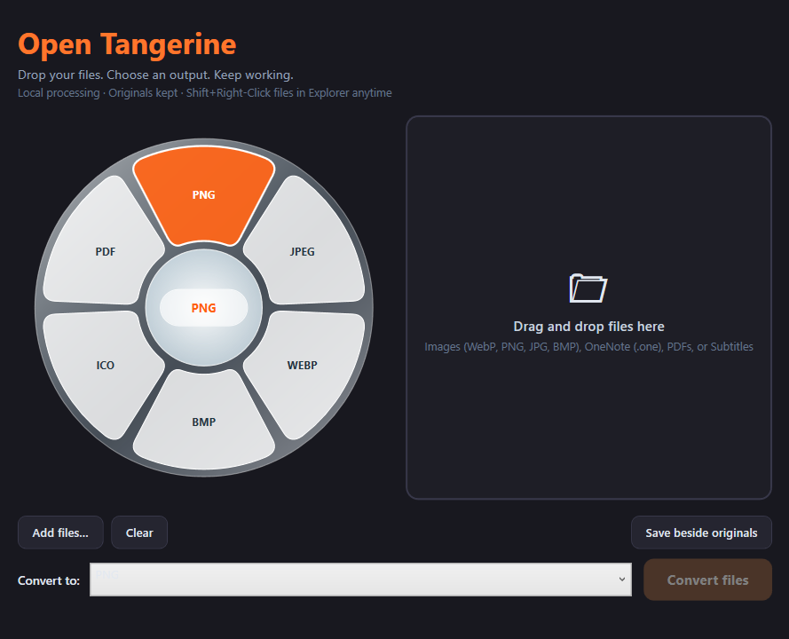

# O-Tangerine (Windows Native Edition)

A high-performance, native Windows file conversion suite inspired by **[Open Tangerine](https://github.com/sintaxerrorpvtltd/Open-Tangerine)**. While Open Tangerine served as the conceptual baseline, **O-Tangerine** has been completely re-engineered from the ground up for the Windows ecosystem with native Win32/WPF architecture, compact frosted glass aesthetics, seamless drag-and-drop workflows, and full Microsoft OneNote (`.one`) document conversion.



---

## 🍊 Key Highlights

- **Native Drag + Hold Shift Workflow (Signature Interaction)**:
  - Drag any file(s) in Windows File Explorer or Desktop while holding the `Shift` key.
  - The compact **frosted glass radial wheel** instantly blooms around your cursor.
  - Drop the file(s) onto your target format slice (PNG, JPEG, WEBP, PDF, DOCX, etc.) to immediately create converted copies right next to the original files!
  - Drop onto the center hub circle (`DROP`) or press `Escape` to cancel.
- **Alternative Shift + Right-Click**:
  - Hold `Shift` and right-click on any file(s) in File Explorer to bring up the wheel and convert via click or release.
- **Refined Compact Frosted Glass Radial Wheel**:
  - Compact, ergonomic geometry (diameter ~230px) optimized for rapid gesture targeting.
  - Translucent acrylic frosted glass styling with subtle refraction and crisp white specular rim.
  - Slices illuminate with a vibrant Electric Tangerine backlight (`#FF6619` / `#FF9847` / `#DE3800`) on hover with white glowing typography.
- **Microsoft OneNote (`.one`) Document Support**:
  - Convert `.one` notebook files directly to **PDF** and editable **DOC / DOCX**.
  - Retains document structure, embedded media, tables, and typography.
- **Rich Media & Image Engine**:
  - **Images**: PNG, JPEG, WEBP, BMP, ICO with SkiaSharp hardware-accelerated processing.
  - **Image → PDF**: Bundle or export single/batch images into high-resolution multi-page PDF documents.
  - **Subtitles**: Bidirectional SRT ↔ WebVTT conversion.
  - **Audio/Video**: Media conversions via installed FFmpeg (MP4, WEBM, MP3, WAV, FLAC, OGG).
- **Desktop Companion Window**:
  - Drag-and-drop batch drop area with Tangerine orange glow on file hover.
  - Embedded interactive glass wheel synced with format selector.
  - File queue with per-file status, queue clearance, and output folder customization.
- **Ultra Lightweight & Fast**:
  - Native .NET 9 + SkiaSharp (~25–35MB memory footprint).
  - Single-instance system tray daemon with "Start with Windows" support, audible chime, and toast notifications.

---

## ⚡ How It Works

### Drag & Drop (Recommended):
```
[Drag File(s)] ──> [Hold Shift] ──> [Compact Frosted Glass Wheel Appears]
                                                    │
                                                    ▼
                                    [Drop onto format (e.g. PNG, PDF, DOCX)]
                                                    │
                                                    ▼
                                    [Converted file(s) saved in same folder]
```

### Shift + Right-Click:
```
[Select File(s)] ──> [Hold Shift + Right-Click] ──> [Glass Wheel Appears]
                                                             │
                                                             ▼
                                                [Release on slice or Click]
                                                             │
                                                             ▼
                                                [Converted in-place!]
```

### Desktop Companion Window:
- Double-click the orange citrus icon in your system tray or run `dotnet run`.
- Drag and drop files directly into the drop zone, choose an output format from the embedded wheel or dropdown, and click **Convert files**.

---

## 🛠 Project Structure

```
├── Core/
│   ├── Models/
│   │   └── ConversionOption.cs     # Format definitions and O-Tangerine styling
│   └── Services/
│       ├── IFileConverter.cs       # Extensible single & batch converter contract
│       ├── ImageConverter.cs       # SkiaSharp image transcode, PDF export & FFmpeg bridge
│       ├── OneNoteConverter.cs     # Microsoft OneNote (.one) to PDF & DOCX pipeline
│       ├── ExplorerService.cs      # Multi-selection File Explorer & Desktop resolver
│       └── GlobalInputHook.cs      # Low-level WH_MOUSE_LL hook for Drag+Shift & Shift+Right-Click
├── UI/
│   ├── RadialGeometryHelper.cs     # Compact sector geometry & polar hit-testing
│   ├── RadialMenuWindow.xaml       # Compact frosted glass wheel with OLE drag/drop
│   ├── MainWindow.xaml             # O-Tangerine companion desktop batch window
│   └── TrayIconManager.cs          # Native notification area tray manager
├── RadialConvert.Tests/            # Comprehensive unit test suite (12 passing tests)
├── assets/
│   └── screenshot.png              # O-Tangerine application screenshot
├── App.xaml / App.xaml.cs          # Application startup & single-instance lifecycle
└── RadialConvert.sln
```

---


## 🧪 Testing & Execution

### Run Automated Tests:
```powershell
dotnet test
```

### Run the App in Background:
```powershell
dotnet run
```

### Open the Desktop Companion Window:
```powershell
dotnet run -- --window
```

---

## 📜 Attribution & Baseline

O-Tangerine is built upon the interaction concepts pioneered by [Open Tangerine](https://github.com/sintaxerrorpvtltd/Open-Tangerine) (Sintax Error Private Limited), using it as an architectural baseline while delivering a completely custom native C#/.NET 9 Windows engine, Microsoft OneNote conversion pipeline, and downsized frosted glass aesthetics.
